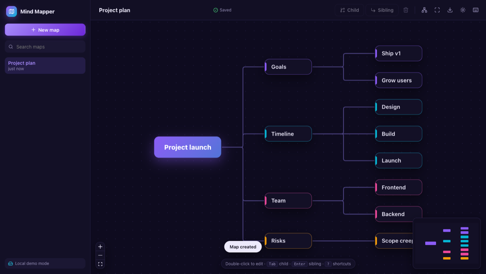
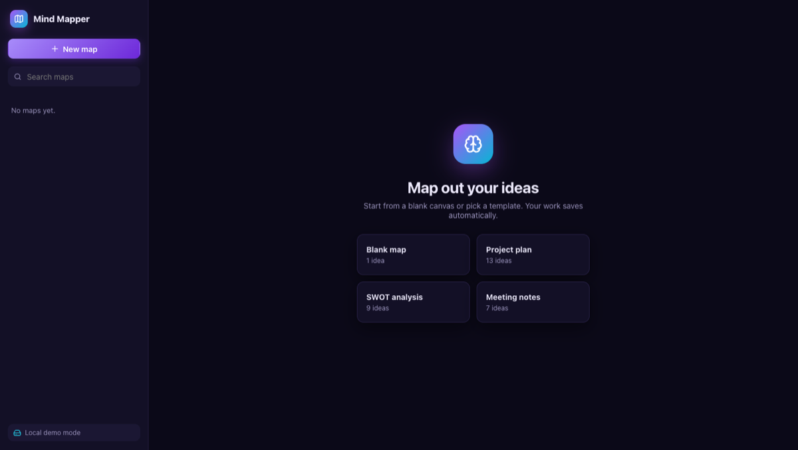
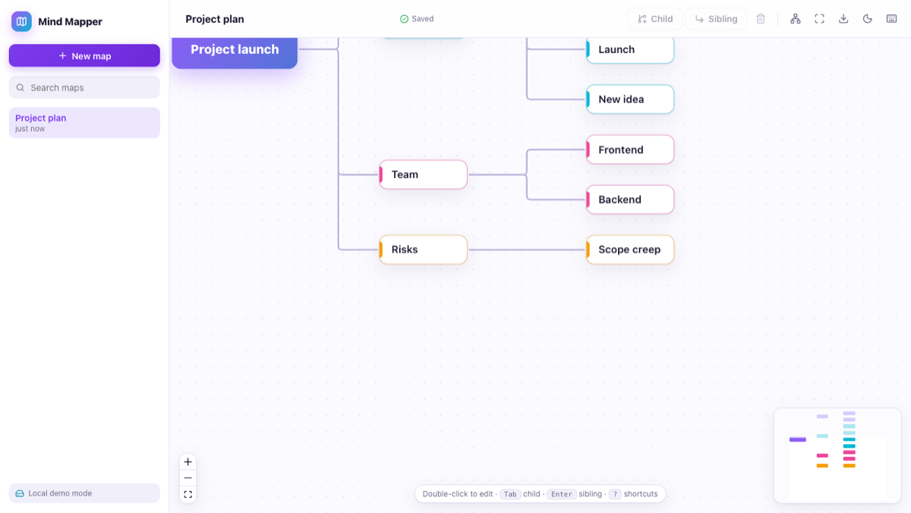
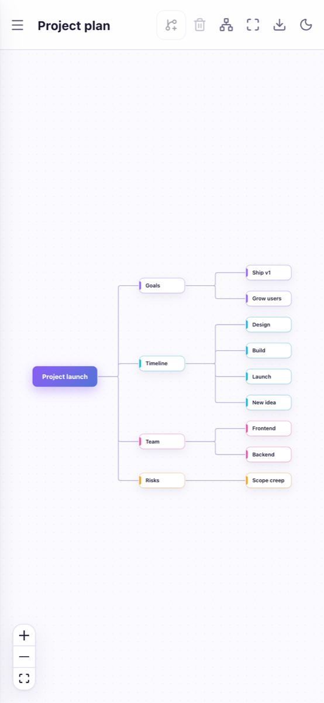
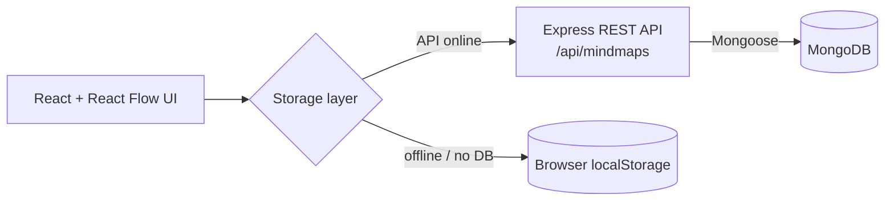

<div align="center">

# 🧠 Mind Mapper

**A fast, visual mind-mapping app. Capture ideas, connect them and keep them organised automatically.**




</div>

## ✨ Features

| | |
|:--|:--|
| 🎨 **Visual editor** | Drag ideas, connect them, zoom and pan on an infinite canvas (React Flow) |
| 🌳 **Auto-arrange** | A tidy tree layout keeps branches from overlapping, however big the map gets |
| ⌨️ **Keyboard first** | `Tab` adds a child, `Enter` a sibling, `Del` deletes a branch, `T` tidies, `F` fits to screen |
| 📝 **Inspector panel** | Edit text, pick from 6 colours and add notes to any idea |
| 💾 **Autosave** | Changes save automatically, with a live "Saving… / Saved" status |
| 🗂️ **Many maps** | Sidebar with search, quick switching and safe two-step delete |
| 🚀 **16 templates** | A searchable gallery with categories. **Basics:** Blank, Brainstorm · **Work:** Project plan, Product roadmap, Meeting notes, Sprint retrospective, Goals &amp; OKRs · **Strategy:** SWOT, Decision making, Problem solving (5 Whys), Customer journey, Business model · **Personal:** Study notes, Weekly planner, Event planning, Book summary |
| 🖼️ **Export** | Download the whole map as a PNG |
| 🌗 **Light & dark** | Follows your system theme, with a one-click toggle |
| 📱 **Responsive** | Slide-in sidebar and bottom-sheet inspector on phones |
| 🧭 **Guided tour** | A 9-step interactive walkthrough with a spotlight on each control. It starts on the first visit and can be replayed from **Guide** |
| 🎲 **Demo data** | Four realistic sample maps (patient portal plan, sprint planning, React learning path, team sync) load on the first visit, or any time with **Load demo maps** |
| 🔌 **Works offline** | If the API or database isn't available, it switches to a local demo mode that saves in the browser |

## 📸 Screenshots

<table>
<tr>
<td width="50%"><br/><sub>Start screen with templates</sub></td>
<td width="50%"><br/><sub>Light mode with the inspector panel</sub></td>
</tr>
</table>

<p align="center"><br/><sub>Mobile view</sub></p>

## 🏗️ How it works



- **`src/lib/mapOps.js`**: pure, unit-tested logic for adding, removing and laying out ideas (no React inside).
- **`src/api/storage.js`**: one interface for saving maps. It checks `/api/health` and uses the API when the database is connected, otherwise localStorage.
- **`src/lib/demoData.js`**: builds the sample maps from a simple nested outline.
- **`src/components/`**: `MindNode`, `Sidebar`, `Toolbar`, `Inspector`, `Tour` (guided walkthrough) and dialogs.
- **`server/`**: Express 5 + Mongoose, with input validation and clean JSON errors.

## 🔌 API

| Method | Endpoint | What it does |
|---|---|---|
| `GET` | `/api/health` | Server status and whether the database is connected |
| `GET` | `/api/mindmaps` | List maps (title and dates only) |
| `GET` | `/api/mindmaps/:id` | Get one map with its nodes and edges |
| `POST` | `/api/mindmaps` | Create a map |
| `PUT` | `/api/mindmaps/:id` | Update the title, nodes or edges |
| `DELETE` | `/api/mindmaps/:id` | Delete a map |

## 🚀 Run it locally

**You need:** Node.js 18+. MongoDB is optional; without it the app runs in local demo mode.

```bash
# 1. Install
npm install
cd server && npm install && cd ..

# 2. (Optional) connect MongoDB
cp server/.env.example server/.env      # then add your MONGO_URI

# 3. Start the API (terminal 1)
npm run server                          # http://localhost:5000

# 4. Start the app (terminal 2)
npm run dev                             # http://localhost:3000
```

| Script | What it does |
|---|---|
| `npm run dev` | Start the app with hot reload (API calls are proxied to port 5000) |
| `npm run build` | Production build into `dist/` |
| `npm test` | Run the unit tests (Vitest) |
| `npm run server` | Start the Express API |

## 🗺️ Roadmap

- [ ] Undo / redo (Command pattern)
- [ ] Export to PDF and JSON import/export
- [ ] Real-time collaboration (Socket.IO)
- [ ] Live demo deployment

---

Built by [Shivanjali Desai](https://github.com/shivanjali24-03)
