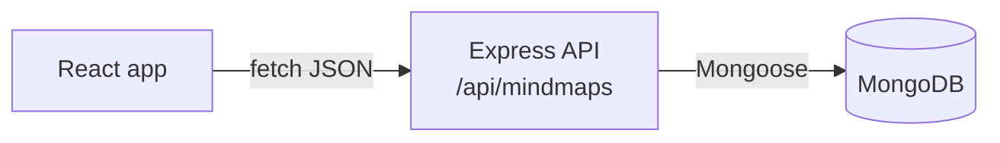

<div align="center">

# 🧠 Mind Mapper

**A full-stack app for capturing ideas as mind maps and saving them to the cloud.**


</div>

## What it does

Mind Mapper lets you organise thoughts as a **mind map**: one central title with connected ideas (nodes) around it. Each map is saved to **MongoDB** through a REST API, so your ideas are still there next time.

## How it works



| Layer | Tech | What it does |
|---|---|---|
| Frontend | React 19 | The user interface |
| Backend | Node.js + Express 5 | REST API with JSON in and JSON out |
| Database | MongoDB + Mongoose | Stores each map's `title`, `nodes` and `createdAt` |

## API

| Method | Endpoint | What it does |
|---|---|---|
| `POST` | `/api/mindmaps` | Create a new mind map |
| `GET` | `/api/mindmaps` | Get all mind maps |

## Run it locally

**You need:** Node.js 18+ and a MongoDB database (local, or a free [MongoDB Atlas](https://www.mongodb.com/atlas) cluster).

```bash
# 1. Backend
cd server
npm install
echo "MONGO_URI=your_mongodb_connection_string" > .env
node server.js              # runs on http://localhost:5000

# 2. Frontend (in a new terminal, from the project root)
npm install
npm start                   # opens on http://localhost:3000
```

Other scripts in the project root: `npm test` runs the tests, and `npm run build` makes a production build.

## Roadmap

- [ ] Drag-and-drop visual node editor
- [ ] Update and delete endpoints (full CRUD)
- [ ] User accounts
- [ ] Live demo

## License

This project is licensed under the [MIT License](LICENSE).

---

Built by [Shivanjali Desai](https://github.com/shivanjali24-03)
